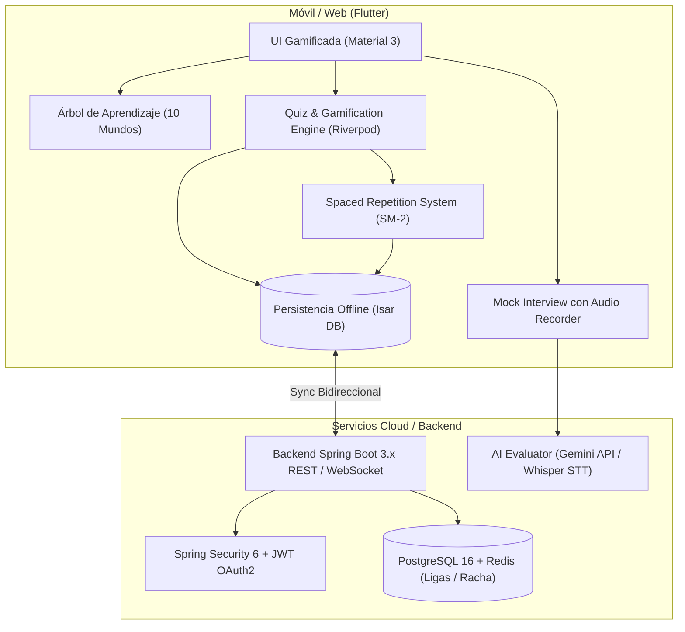

# 🗺️ Plan Maestro de Implementación: Java & Spring Interview Duolingo

Este plan detalla la hoja de ruta para evolucionar **JavaPlay** desde el MVP actual hacia una plataforma completa de grado industrial para la preparación de entrevistas técnicas Senior y Staff.

---

## 🏛️ Arquitectura General del Sistema

---

## 📅 Fases de Implementación

### Fase 1: Enriquecimiento de Ejercicios y UI/UX (Semanas 1 - 2)
> **Objetivo**: Elevar la interactividad y fidelidad al estándar visual y mecánico de Duolingo.

- [ ] **Nuevos Tipos de Ejercicios Técnicos**:
  - **Spot the Bug (Code Tapping)**: El usuario visualiza un método Java con un error sutil (ej. `Double-Checked Locking` sin `volatile` o `@Transactional` en método privado) y debe tocar la línea exacta donde reside el bug.
  - **Big-O & Complexity Matcher**: Emparejar operaciones de colecciones (`ConcurrentHashMap.put()`, `ArrayList.add()`, `TreeMap.get()`) con su complejidad temporal y espacial ($O(1)$, $O(\log n)$, $O(n)$).
  - **JVM Argument Builder**: Arrastrar modificadores de rendimiento de la JVM (`-Xmx4g`, `-XX:+UseZGC`, `-Xss512k`, `-XX:+HeapDumpOnOutOfMemoryError`) según un requerimiento de producción.
- [ ] **Efectos y Micro-Animaciones**:
  - Efecto de rebote 3D en tarjetas y botones (`Transform.translate` en presión).
  - Confeti animado al completar lecciones y rachas (`confetti` package).
  - Transición fluida de la barra de progreso superior con interpolación elástica.
- [ ] **Tienda de Recompensas (Shop)**:
  - Compra de "Recargas de Vidas" usando gemas acumuladas.
  - "Streak Freeze" (escudo para no perder la racha si un día no se practica).

---

### Fase 2: Repetición Espaciada (SRS) y Persistencia Offline (Semanas 3 - 4)
> **Objetivo**: Asegurar retención a largo plazo con almacenamiento local sin conexión.

- [ ] **Algoritmo SM-2 (SuperMemo-2)**:
  - Cada concepto/pregunta tiene un intervalo de revisión ($1, 3, 7, 14, 30$ días) basado en si el usuario acertó al primer intento o requirió reintentos.
  - Las preguntas falladas se reinsertan automáticamente en la cola de repaso diario.
- [ ] **Base de Datos Local con Isar**:
  - Modelos indexados: `UserProgress`, `ExerciseStats`, `StreakRecord`, `OfflineCurriculum`.
  - Cero tiempos de carga y funcionamiento 100% offline.
- [ ] **Expansión del Curriculum a 10 Mundos**:
  1. Java Core, OOP & JVM Internals (Stack, Heap, Metaspace, GC ZGC/G1).
  2. Collections, Generics & Streams API.
  3. Multithreading, JMM & Virtual Threads (Project Loom, Java 21).
  4. Spring Boot Core, IoC Container, Bean Lifecycle & Proxies.
  5. Spring Data JPA, Hibernate, N+1 & Transacciones.
  6. Spring Security 6 & OAuth2 / JWT.
  7. Microservicios, Resiliencia (Resilience4j) & Spring Cloud.
  8. Mensajería Asíncrona (Apache Kafka, RabbitMQ).
  9. Estrategias de Testing (JUnit 5, Mockito, Testcontainers, ArchUnit).
  10. Cloud Native, Docker, Kubernetes & Observabilidad (Micrometer, Actuator).

---

### Fase 3: Simulador de Entrevistas con IA (Semanas 5 - 6)
> **Objetivo**: Transformar el Mock Interview de una autoevaluación pasiva a un entrevistador técnico interactivo.

- [ ] **Transcripción de Voz (Speech-to-Text)**:
  - Conversión del audio grabado a texto para evaluar la fluidez y terminología técnica usada.
- [ ] **Evaluador Semántico con IA (Gemini API)**:
  - Prompt especializado con rol de *Senior Java Interviewer*.
  - Calificación en 3 ejes:
    1. **Precisión Técnica** (Uso correcto de conceptos como *Proxy CGLIB*, *Stateless*, *Memory Barrier*).
    2. **Estructura de Comunicación** (Contexto ➔ Causa Raíz ➔ Solución ➔ Trade-offs).
    3. **Preguntas de Repregunta (Follow-ups)** personalizadas según la respuesta dada por el usuario.

---

### Fase 4: Backend Spring Boot, Ligas y Modo Multijugador (Semanas 7 - 8)
> **Objetivo**: Escalabilidad, tablas de clasificación social y sincronización entre dispositivos.

- [ ] **Backend Spring Boot 3.3**:
  - Arquitectura Hexagonal / Clean Architecture.
  - Base de datos PostgreSQL con migraciones Flyway.
  - Redis para leaderboard global de XP en tiempo real (Sorted Sets).
- [ ] **Sistema de Ligas Semanales**:
  - Ligas: *Bronce ➔ Plata ➔ Oro ➔ Platino ➔ Diamante ➔ JVM Staff Master*.
  - Ascensos de los 10 primeros usuarios cada domingo a medianoche.
- [ ] **Duelo Técnico en Tiempo Real (1v1 WebSocket)**:
  - Dos usuarios compiten contra el reloj para resolver 5 preguntas de código en 60 segundos.

---

### Fase 5: Gamificación Avanzada, Economía y Efectos Sensoriales
> **Objetivo**: Máxima retención diaria, recompensas emocionales y pulido audiovisual de clase mundial.

- [ ] **Tienda de Ítems (Gems Economy)**:
  * **Streak Freeze (Protector de Racha)**: Escudo que se activa automáticamente si el usuario no ingresa un día, salvando su récord.
  * **Recarga de Vidas**: Compra de corazones con gemas acumuladas al responder correctamente.
  * **Personalización & Cosméticos**: Insignias especiales, títulos para el perfil y skins de programador.
- [ ] **Efectos Audiovisuales & Feedback Háptico**:
  * Sonidos satisfactorios estilo Duolingo en aciertos, errores y fanfarria al derrotar jefes.
  * Explosión de confeti animada al subir de nivel o completar un mundo.
  * Vibración háptica en dispositivos móviles al seleccionar o enviar respuestas.
- [ ] **Modo Contrarreloj "JVM Heap Survival"**:
  * Simulación visual del Heap de memoria llenándose con objetos segundo a segundo.
  * Cada respuesta correcta ejecuta un *Garbage Collection (GC)* liberando memoria; cada fallo o demora acelera la llegada del `OutOfMemoryError`.

---

### Fase 6: ☕ "Java Action Sim: El Algoritmo Vivo" (Simulador Causa-Efecto)
> **Objetivo**: Transformar el aprendizaje de código en una experiencia interactiva donde cada instrucción Java hace que un personaje realice acciones físicas en pantalla.

- [ ] **Mecánica Central (Programación Visual Orientada a Objetos)**:
  * El usuario no solo responde preguntas teóricas: **ensambla o escribe instrucciones Java** para que el personaje (Duke o el Dev) interactúe con el entorno (ej. preparar café, despachar pedidos, coordinar hilos).
  * **Ejecución Línea por Línea (Visual Debugger)**: Al pulsar "▶️ EJECUTAR", el código se va resaltando instrucción por instrucción y el personaje ejecuta la acción en tiempo real con animaciones fluidas (Lottie / Canvas).
- [ ] **Feedback Visual con Humor Técnico de Java**:
  * Si el código es correcto: El personaje completa la tarea con éxito (ej. café humeante servido, hilo sincronizado).
  * **`NullPointerException`**: El personaje intenta agarrar un objeto inexistente (`taza = null`) y se le cae al piso con sonido de vidrio rompiéndose.
  * **`StackOverflowError`**: El personaje entra en un bucle recursivo infinito sirviendo tazas una dentro de otra hasta saturar la cocina.
  * **`Deadlock`**: Dos personajes intentan tomar la cafetera y la taza al mismo tiempo con bloqueos cruzados y se quedan congelados mirándose.
  * **`ArrayIndexOutOfBoundsException`**: El personaje intenta colocar una taza en `bandeja[5]` cuando la bandeja solo tiene 3 ranuras, cayéndose al vacío.
- [ ] **Entornos Progresivos**:
  * **Mundo 1 (Fundamentos)**: *La Cafetería JVM* (instanciación, llamadas a métodos `calentar()`, `moler()`, `servir()`).
  * **Mundo 2 (Colecciones & Loops)**: *El Almacén de Despacho* (`for-each`, `List.add()`, filtrado con Streams).
  * **Mundo 3 (Multithreading)**: *La Cocina Concurrente* (sección crítica con `synchronized`, `ReentrantLock` y evitar condiciones de carrera).

---

## 🚀 Próximos Pasos Disponibles para Desarrollo Inmediato
1. **Implementar "Java Action Sim: La Cafetería JVM"**: Crear el primer micro-escenario visual donde el código del usuario controla físicamente al personaje paso a paso con animaciones.
2. **Tienda de Gemas & Protector de Racha (Streak Freeze)**.
3. **Efectos de Audio, Háptica y Confeti**.
